# 基于LangGraph的电商AI智能客服系统

---

## 1. 项目概述

本系统是一个面向电商场景的 **AI 智能客服平台**。用户在网页端以对话方式（支持文字 + 图片）咨询问题，系统通过 **LangGraph 多智能体** 自动识别意图，并分派给不同的专职智能体处理：

| 用户诉求 | 处理智能体 | 处理方式 |
| --- | --- | --- |
| 退换货、积分、优惠券、物流政策等规则咨询 | 知识库客服（Knowledge） | RAG 检索知识库后作答，并返回引用来源 |
| 查订单、查物流、搜商品、取消订单 | 工具客服（Tool） | ReAct 智能体调用业务工具读写 MySQL |
| 投诉、要人工、商品破损、质量纠纷 | 工单客服（Ticket） | 大模型总结问题、分级分类，自动创建工单 |
| 问候、感谢、身份询问 | 闲聊客服（Chitchat） | 友好接待并引导用户使用各项能力 |

### 系统角色

- **普通用户（user）**：注册 / 登录、智能客服对话（多会话）、个人中心（资料、头像、密码）。
- **管理员（admin）**：控制台统计、会话监控（只读）、商品管理、订单管理、知识库管理、工单管理、用户管理、个人中心。

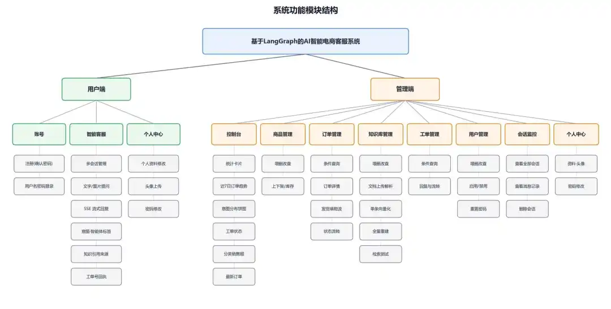
---

## 2. 业务逻辑

### 2.1 核心业务闭环

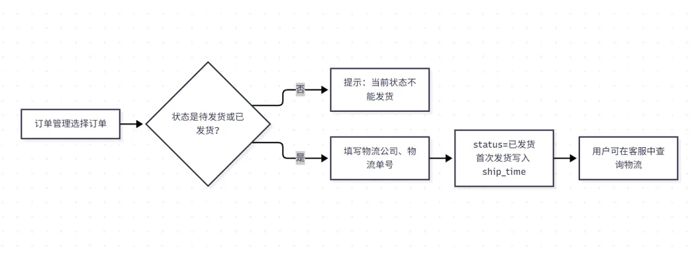

用户通过网页端发起咨询（支持文字+图片输入）→ 系统自动识别用户意图 → 分派给对应专职智能体处理 → 流式返回回答结果 → 业务数据持久化存储 → 管理员后台完成后续运维、工单处理、知识库迭代，形成完整业务闭环。

### 2.2 意图识别规则

| 意图 | 含义 | 典型关键词（模型失败时的兜底规则） |
| --- | --- | --- |
| knowledge | 规则政策咨询 | 默认兜底意图 |
| tool | 需要读取或修改系统数据 | 订单、物流、快递、发货、取消、单号 |
| ticket | 需要人工介入 | 工单、投诉、人工、破损、坏了、质量问题、裂了；或有图片且包含 坏/破/损/退 |
| chitchat | 寒暄 | 你好、您好、谢谢、再见、你是谁、在吗 |

**优先级约定**：同时涉及政策与具体订单时优先 tool；用户明确投诉或图片显示破损时优先 ticket。

### 2.3 订单状态流转

订单状态取值：**待付款、待发货、已发货、已完成、已取消、退款中**。用户可通过智能客服取消 **待付款 / 待发货** 订单，管理员可在后台发货或直接修改状态（系统会自动补齐支付、发货、完成时间）。

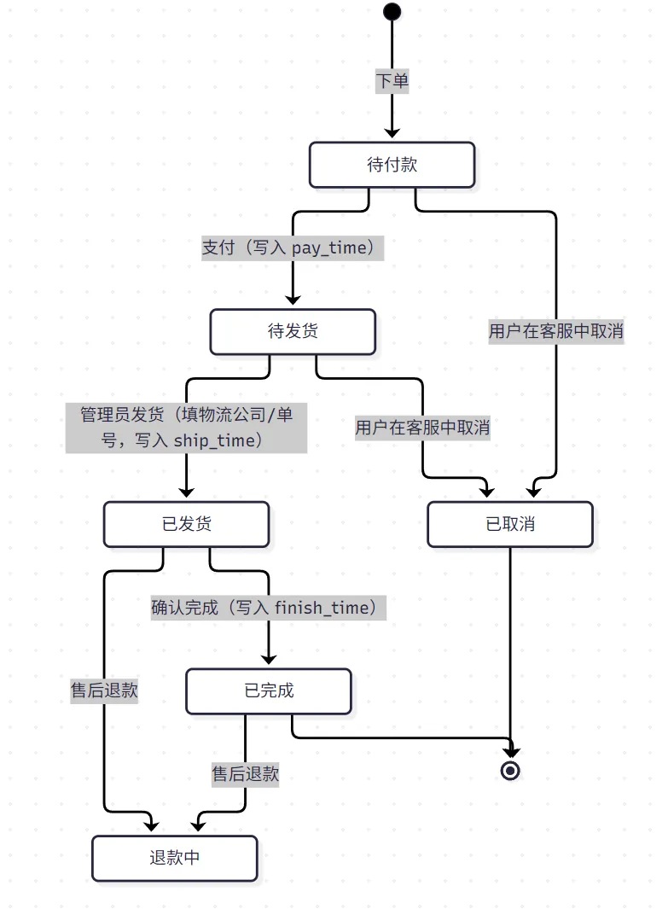

### 2.4 工单状态流转

工单由工单客服智能体自动创建（初始状态为**待处理**），管理员回复时写入 handler_id 并流转状态。

- **工单分类**：商品问题、物流问题、售后问题、账户问题、其他
- **优先级**：低、中、高（破损、投诉默认高）
- **工单状态**：待处理、处理中、已解决、已关闭

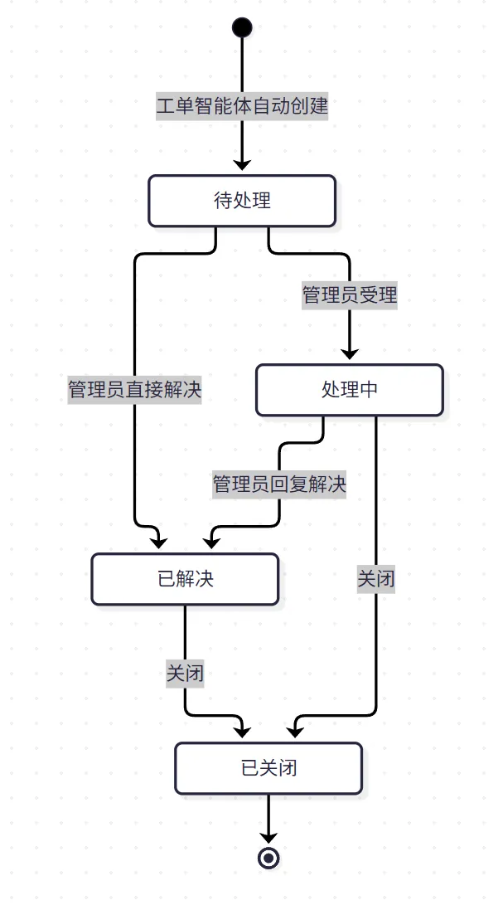

### 2.5 知识向量状态

| 状态 | 触发条件 |
| --- | --- |
| 未向量化 | 新建初始值；或嵌入模型调用失败（chunk_count 置 0，原文保留） |
| 已向量化 | 新增 / 修改 / 单条向量化 / 全量重建成功，chunk_count 记录切片数 |

---

## 3. 技术栈

| 层次 | 技术 | 说明 |
| --- | --- | --- |
| 前端框架 | Vue 3.5 + Vite 8 | 单页应用，@ 指向 src |
| UI 组件 | Element Plus 2 + @element-plus/icons-vue | 表格、表单、布局 |
| 状态 / 路由 | Pinia 4、Vue Router 5 | 保存 token 与用户信息；按角色路由守卫 |
| 网络 | Axios（普通接口）、fetch + ReadableStream（SSE 流式对话） | 拦截器注入 Authorization: Bearer |
| 图表 / 渲染 | ECharts 6、markdown-it、dayjs | 控制台统计图；渲染模型 Markdown 回复；日期格式化 |
| 后端框架 | FastAPI + Uvicorn | REST 接口、StreamingResponse SSE 推送 |
| ORM / 驱动 | SQLAlchemy 2 + PyMySQL | 实体映射，表名均以 t\_ 开头 |
| 鉴权 | PyJWT（HS256，有效期 72 小时） | get_current_user、get_admin 依赖注入 |
| 智能体编排 | LangGraph（StateGraph、create_react_agent） | 路由 + 四个专职智能体 |
| 大模型接入 | LangChain + langchain-openai | 阿里云百炼 OpenAI 兼容接口 |
| 对话模型 | qwen3.8-27b | 支持图片多模态输入，关闭思考模式 |
| 嵌入模型 | text-embedding-v4（2048 维） | 知识切片向量化 |
| 向量库 | Chroma（langchain-chroma，本地持久化） | 集合 ecommerce_knowledge，余弦距离 |
| 文档处理 | langchain-text-splitters、pypdf、python-docx | 切分 500 / 重叠 80；解析 pdf、docx、txt、md |
| 关系数据库 | MySQL 8（端口 3308） | 库名 db_ai_customer_service，utf8mb4 |
| 文件存储 | 本地磁盘 D:/uploads61 | 头像、商品图、聊天图片、知识文档，经 /uploads 静态访问 |

---

## 4. 系统架构

### 4.1 总体分层架构

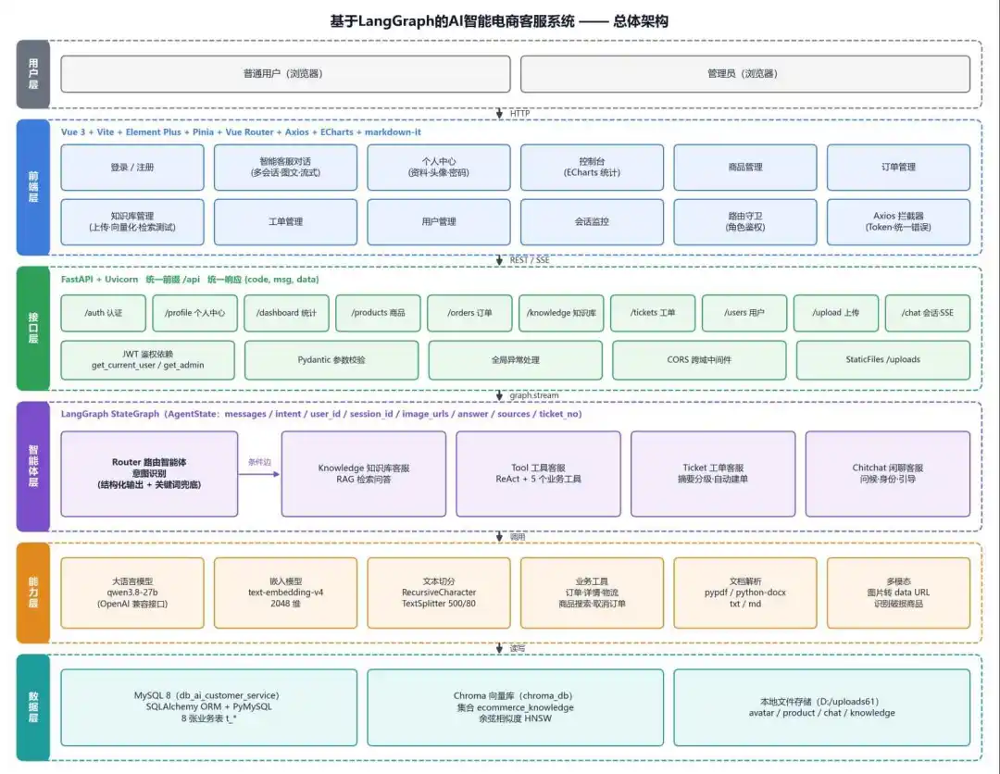

系统自上而下分为 **用户层、前端层、接口层、智能体层、能力层、数据层** 六层：

- **前端层**：Vue 3 单页应用，按角色划分用户端与管理端页面，路由守卫拦截越权访问。
- **接口层**：FastAPI 汇总 10 组路由，统一前缀 /api、统一响应结构 {code, msg, data}，全局处理 HTTPException 和参数校验异常。
- **智能体层**：LangGraph 状态图，Router 通过条件边把请求分派给四个智能体。
- **能力层**：大语言模型、嵌入模型、文本切分、业务工具、文档解析、多模态图片识别。
- **数据层**：MySQL 存业务数据，Chroma 存知识向量，本地目录存上传文件。

### 4.2 部署与运行架构

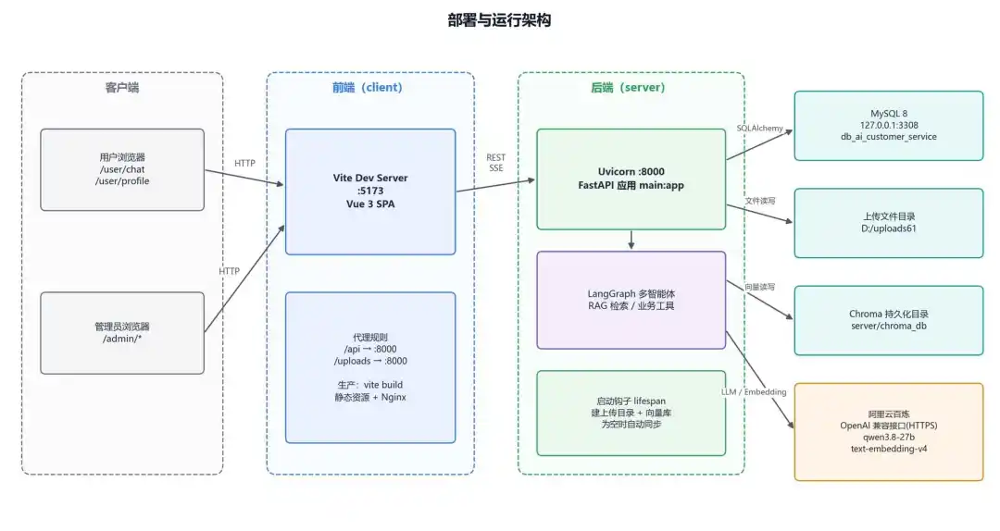

开发环境下前端运行在 Vite :5173，通过代理把 /api、/uploads 转发到后端 :8000。

后端启动时（lifespan）会创建上传子目录 avatar / product / chat / knowledge，并在 Chroma 为空时把 t_knowledge 全量向量化。

大模型 API Key 从环境变量 OPENAI_API_KEY 读取。

### 4.3 工程目录结构

`基于LangGraph的AI智能电商客服系统`\
`├─ client/                      前端（Vue 3 + Vite）`\
`│  ├─ src/api/index.js          全部接口封装`\
`│  ├─ src/utils/request.js      Axios 实例与拦截器`\
`│  ├─ src/stores/user.js        Pinia 用户状态（token/角色/资料）`\
`│  ├─ src/router/index.js       路由表 + 角色守卫`\
`│  ├─ src/layout/TopLayout.vue  顶部导航布局（头像下拉：个人中心/安全退出）`\
`│  ├─ src/components/ChatPanel.vue  智能客服对话面板（SSE 流式渲染）`\
`│  └─ src/views/                登录、注册、个人中心、admin/*、user/*`\
`├─ server/                      后端（FastAPI）`\
`│  ├─ main.py                   应用入口、中间件、异常处理、静态资源`\
`│  ├─ app/core/                 配置、数据库会话、JWT 安全、文件上传与解析、统一响应`\
`│  ├─ app/models/entities.py    SQLAlchemy 实体（8 张表）`\
`│  ├─ app/schemas/schemas.py    Pydantic 请求模型与序列化`\
`│  ├─ app/routers/auth/profile、dashboard、product、order、knowledge、ticket、user、upload、chat`\
`│  ├─ app/agents/graph、state、llm、router/knowledge/tool/ticket/chat 智能体`\
`│  ├─ app/rag/vector_store.py   Chroma 切分、写入、检索、重建`\
`│  ├─ chroma_db/                向量库持久化目录`\
`│  └─ sql/db_ai_customer_service.sql  建库建表与测试数据`\
`└─ assets/                      本文档架构图及绘图脚本`

### 4.4 前端路由与权限

| 路由 | 页面 | 角色 |
| --- | --- | --- |
| /login、/register | 登录、注册（含确认密码） | 匿名 |
| /admin/dashboard | 控制台（统计卡片 + ECharts 图表） | admin |
| /admin/chat | 智能客服会话监控（只读查看全部用户会话与消息，可删除会话） | admin |
| /admin/products / orders / knowledge / tickets / users | 商品 / 订单 / 知识库 / 工单 / 用户管理 | admin |
| /admin/profile | 个人中心（左右布局：资料修改、密码修改、头像上传） | admin |
| /user/chat | 智能客服对话 | user |
| /user/profile | 个人中心 | user |

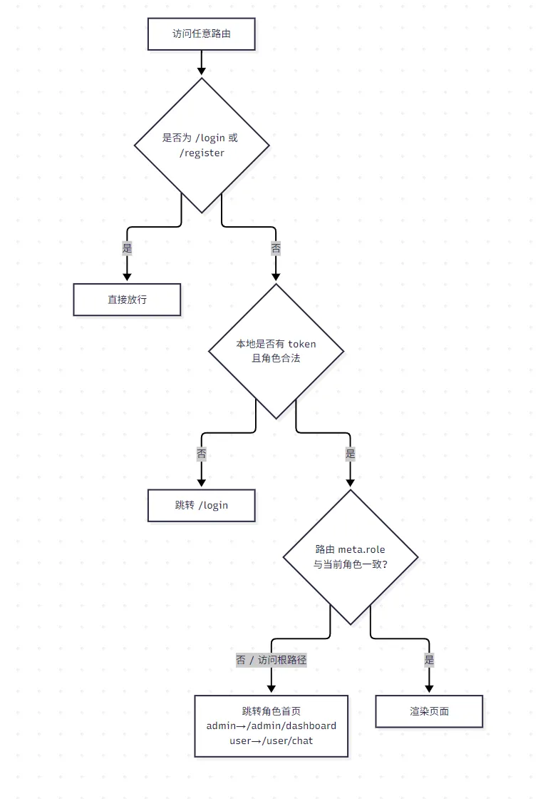
---

## 5. 多智能体设计（LangGraph）

### 5.1 协作架构

系统采用 LangGraph 构建多智能体协作状态图，核心包含一个路由智能体（Router）和四个专职处理智能体，所有节点共享统一的 AgentState 状态，通过条件边实现智能路由分派。

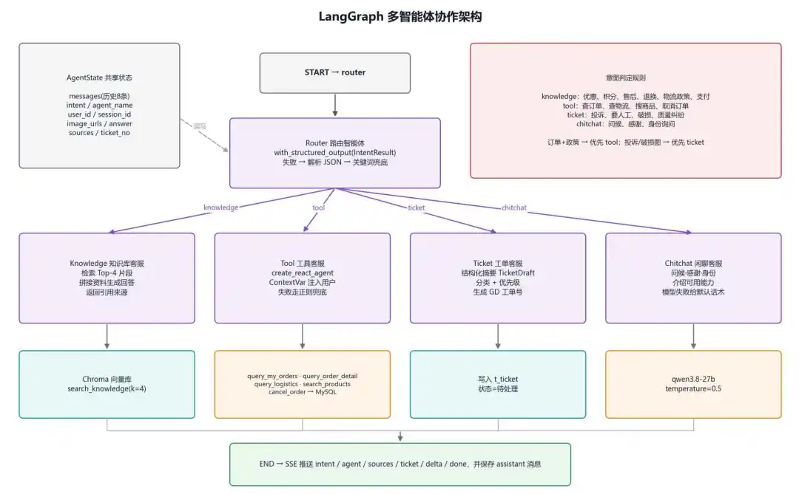

### 5.2 状态图（StateGraph）
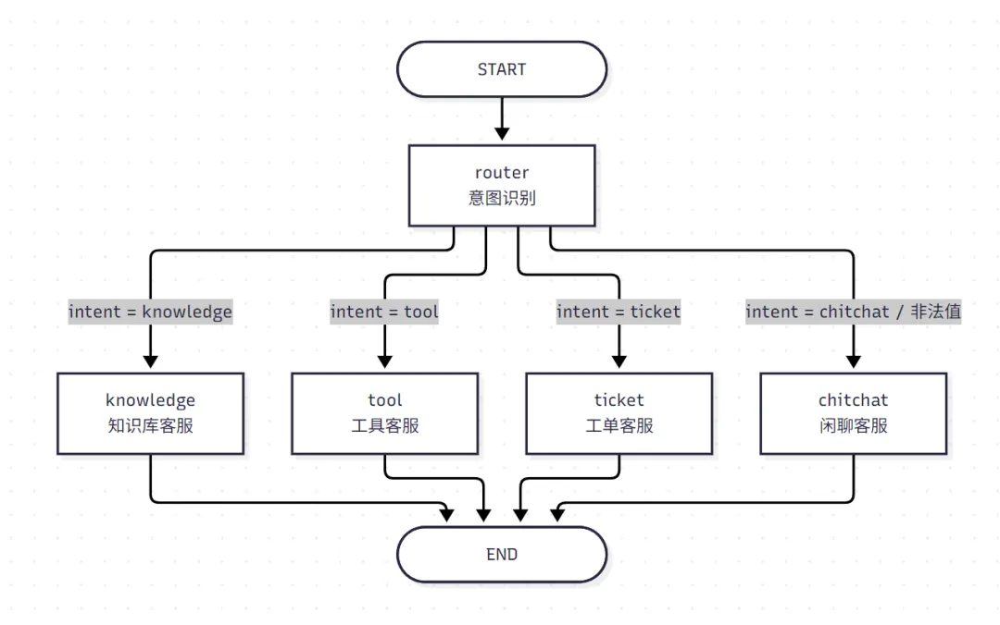

共享状态 AgentState 字段：

| 字段 | 类型 | 说明 |
| --- | --- | --- |
| messages | list（add_messages 归并） | 当前会话最近 8 条消息，当前消息带图片 data URL |
| intent | str | 路由识别出的意图 |
| user_id / session_id | int | 当前用户与会话，供工具和工单使用 |
| image_urls | list | 本次上传的图片地址（最多 3 张） |
| agent_name | str | 处理智能体名称（知识库客服 / 工具客服 / 工单客服 / 闲聊客服） |
| answer | str | 最终回复 |
| sources | list | 知识引用来源（标题、分类、knowledge_id） |
| ticket_no | str | 新建工单号 |

### 5.3 Router 意图识别（三级降级）

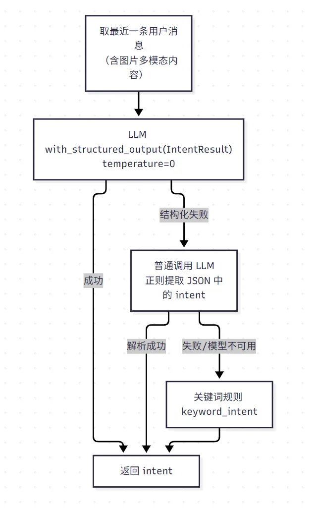

Router 采用三级降级策略保证意图识别可靠性：

1. 第一级：大模型语义识别，优先通过多模态大模型判断用户真实意图
2. 第二级：关键词规则匹配兜底，大模型失败时按预设关键词识别
3. 第三级：默认兜底意图为 knowledge，分派给知识库客服处理

### 5.4 各智能体职责

| 智能体 | 模型参数 | 核心逻辑 | 降级策略 |
| --- | --- | --- | --- |
| Knowledge 知识库客服 | temperature 0.2，流式 | 检索 Top-4 切片，按“【分类｜标题】+正文”拼成资料，要求只依据资料回答 | 无资料时提示用户补充或转工单 |
| Tool 工具客服 | temperature 0.2，流式 | create_react_agent + 5 个工具，ContextVar 注入当前用户 ID，recursion_limit=10 | 智能体失败时用正则识别 DD 开头订单号，按关键词直接调用工具 |
| Ticket 工单客服 | temperature 0 | 结构化输出 TicketDraft（标题≤30字、分类、优先级、摘要），写入 t_ticket，工单号 GD+yyyyMMddHHmmss | 解析 JSON → 默认“售后问题 / 中” |
| Chitchat 闲聊客服 | temperature 0.5，流式 | 问候、身份说明、介绍能力 | 返回固定欢迎话术 |

Tool 智能体的业务工具（全部按当前登录用户隔离数据）：

| 工具 | 参数 | 功能 |
| --- | --- | --- |
| query_my_orders | 无 | 最近 8 笔订单：订单号、状态、金额、下单时间、商品明细 |
| query_order_detail | order_no | 订单详情：支付方式、收货人、电话、地址、商品 |
| query_logistics | order_no | 物流公司、运单号、发货时间 |
| search_products | keyword | 按名称 / 分类 / 描述模糊搜索在售商品（最多 8 条） |
| cancel_order | order_no | 仅“待付款 / 待发货”可取消，其余提示转工单 |

---

## 6. RAG 知识库设计

### 6.1 知识入库与向量化流程

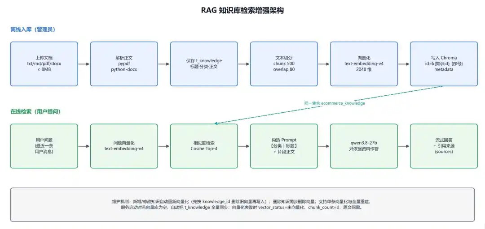

1. 管理员新增知识或上传知识文档（支持pdf/docx/txt/md格式）
2. 系统自动解析文档内容，按 500字符长度、80字符重叠进行文本切分
3. 调用 text-embedding-v4 嵌入模型生成向量
4. 写入 Chroma 向量库持久化存储
5. 更新知识库表中的 vector_status 为“已向量化”，记录 chunk_count
6. 用户提问时检索 Top-K 相关知识片段，拼接为上下文交给大模型生成回答

### 6.2 向量存储约定

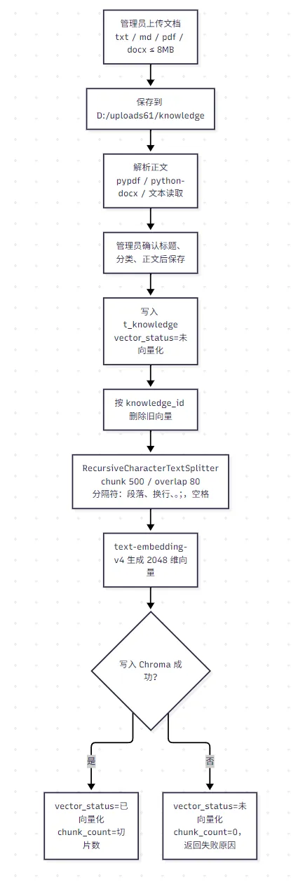

- 集合名：ecommerce_knowledge，距离度量 hnsw:space = cosine。
- 切片 ID：k{知识id}\_{序号}；元数据：knowledge_id、title、category、chunk。
- 修改知识时先删后写，删除知识同步删除向量；支持“单条向量化”“全量重建”“检索测试（Top-K 1\~8）”。

---

## 7. 核心业务流程

### 7.1 登录注册与鉴权

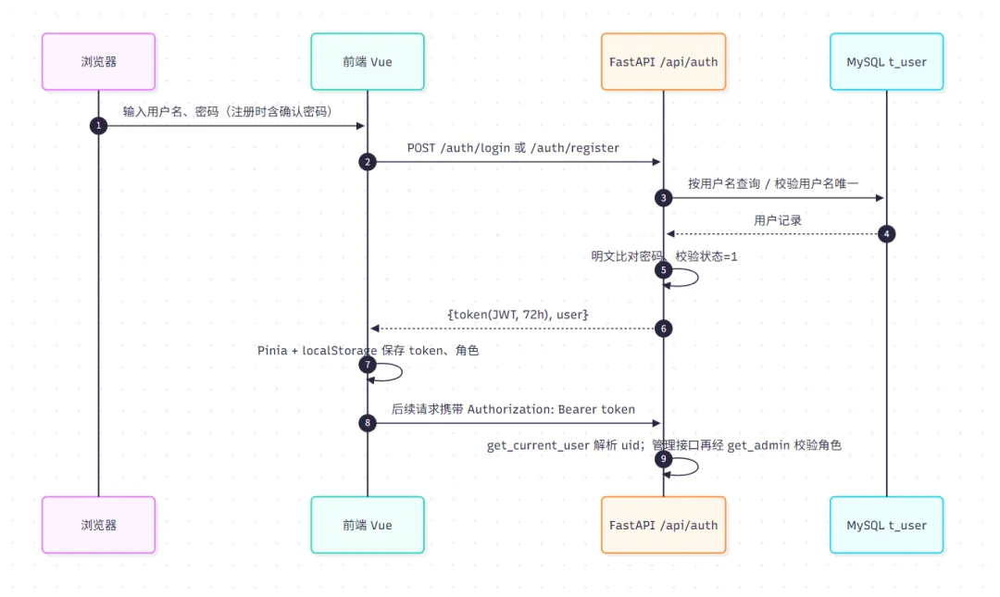

1. 用户提交用户名密码进行注册或登录
2. 后端校验用户信息，生成JWT令牌（有效期72小时）返回前端
3. 前端将token存储在Pinia中，后续所有请求通过Axios拦截器自动在请求头携带 Authorization: Bearer {token}
4. 后端通过依赖注入校验token有效性与用户角色，实现接口权限控制
5. 禁用用户无法登录，令牌立即失效

### 7.2 智能客服流式对话（SSE）

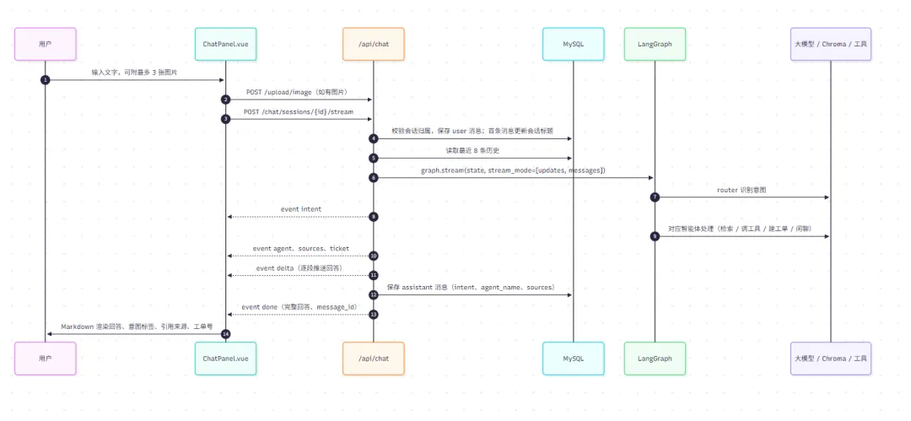

1. 用户选择或新建会话，发送文字/图片消息
2. 后端写入消息到数据库，触发LangGraph状态图执行
3. 路由智能体识别意图，分派给对应专职智能体
4. 智能体处理过程中通过SSE实时推送增量事件
5. 处理完成后推送done事件，完整结果持久化

SSE 事件类型：

| type | 字段 | 说明 |
| --- | --- | --- |
| intent | intent | Router 识别出的意图 |
| agent | agent, intent | 实际处理的智能体名称 |
| sources | sources | 知识库引用来源 |
| ticket | ticket_no | 新创建的工单号 |
| delta | content | 回答增量片段（knowledge/chitchat 为模型 token 流，tool/ticket 按 12 字切片推送） |
| done | answer, intent, agent, sources, ticket_no, message_id | 结束事件 |
| error | message | 处理失败信息 |

### 7.3 工单升级与处理

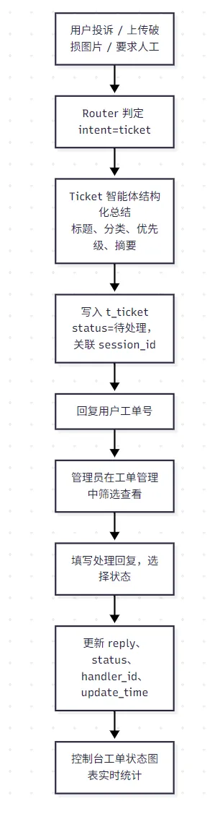

1. 智能客服识别到需要人工介入的诉求（投诉、破损、质量问题等）
2. 工单智能体自动总结问题，生成分级分类的工单，状态为“待处理”
3. 管理员在后台工单列表查看待处理工单，填写回复内容
4. 系统自动写入处理人ID，将工单流转为“处理中”
5. 问题解决后管理员将工单标记为“已解决”或“已关闭”

### 7.4 管理员发货

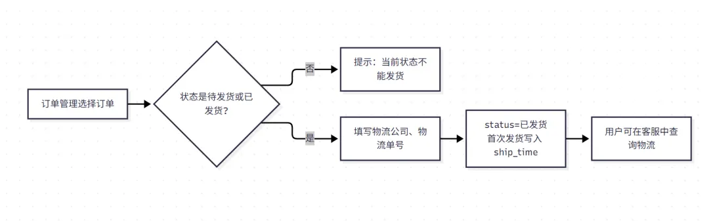

1. 管理员在后台订单列表找到待发货订单
2. 填写物流公司、物流单号，提交发货操作
3. 系统自动将订单状态更新为“已发货”，自动记录发货时间
4. 用户可通过智能客服查询到最新物流信息

---

## 8. 接口设计

所有接口前缀为 /api，响应格式统一为 `{"code": 200, "msg": "成功", "data": ...}`。

| 模块 | 方法与路径 | 权限 | 说明 |
| --- | --- | --- | --- |
| 认证 | POST /auth/login | 匿名 | 用户名密码登录，返回 token |
| 认证 | POST /auth/register | 匿名 | 普通用户注册（确认密码，性别默认男） |
| 认证 | GET /auth/me | 登录 | 当前用户信息 |
| 个人中心 | PUT /profile | 登录 | 修改昵称、性别、手机、邮箱 |
| 个人中心 | POST /profile/avatar | 登录 | 上传头像 |
| 个人中心 | PUT /profile/password | 登录 | 校验原密码后修改 |
| 控制台 | GET /dashboard/overview | 管理员 | 统计卡片、近 7 日订单趋势、意图分布、工单状态、分类销售额、最新订单 |
| 商品 | GET/POST /products，PUT/DELETE /products/{id} | 管理员 | 商品增删改查 |
| 订单 | GET /orders，GET /orders/{id} | 管理员 | 分页查询、详情（含明细） |
| 订单 | PUT /orders/{id}/ship，PUT /orders/{id}/status | 管理员 | 发货、修改状态 |
| 知识库 | GET/POST /knowledge，PUT/DELETE /knowledge/{id} | 管理员 | 知识增删改查（自动向量化） |
| 知识库 | POST /knowledge/upload | 管理员 | 上传并解析文档 |
| 知识库 | POST /knowledge/{id}/vectorize，POST /knowledge/rebuild | 管理员 | 单条向量化、全量重建 |
| 知识库 | POST /knowledge/search | 管理员 | 检索测试 |
| 工单 | GET /tickets，PUT /tickets/{id} | 管理员 | 查询、回复与流转 |
| 用户 | GET/POST /users，PUT/DELETE /users/{id} | 管理员 | 用户增删改查（不能删除自己） |
| 用户 | PUT /users/{id}/reset-password | 管理员 | 重置密码为 123456 |
| 上传 | POST /upload/image | 登录 | 上传聊天 / 商品图片 |
| 会话 | GET/POST /chat/sessions | 登录 | 我的会话 / 新建会话；管理员 scope=all 查看全部 |
| 会话 | DELETE /chat/sessions/{id} | 登录 | 删除会话及消息 |
| 会话 | GET /chat/sessions/{id}/messages | 登录 | 会话消息列表 |
| 会话 | POST /chat/sessions/{id}/stream | 登录 | SSE 流式问答 |
| 健康检查 | GET /health | 匿名 | 服务状态 |

---

## 9. 数据库设计

数据库：db_ai_customer_service（MySQL 8，InnoDB，字符集 utf8mb4），共 8 张表。表之间使用 逻辑外键（建有普通索引，不建物理外键约束），由应用层维护一致性。

### 9.1 E-R 关系图

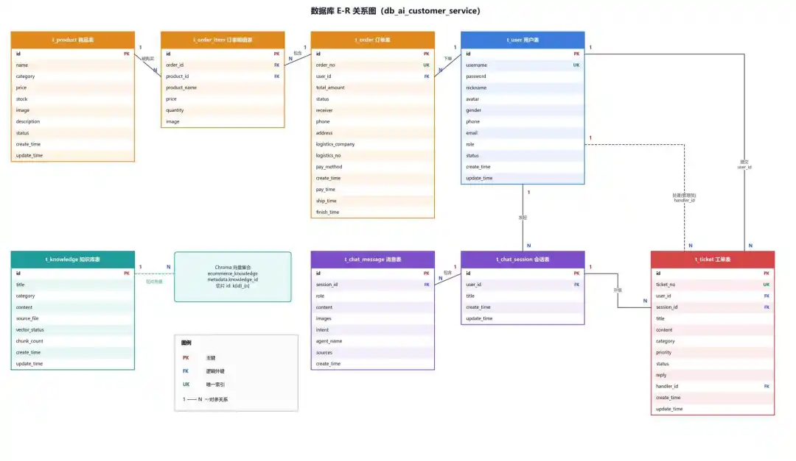

| 关系 | 说明 |
| --- | --- |
| t_user 1 : N t_order | 一个用户可下多个订单（t_order.user_id） |
| t_order 1 : N t_order_item | 一个订单包含多条商品明细（t_order_item.order_id） |
| t_product 1 : N t_order_item | 一个商品可出现在多条明细中（t_order_item.product_id，明细保存名称、价格、图片快照） |
| t_user 1 : N t_chat_session | 一个用户可有多个客服会话 |
| t_chat_session 1 : N t_chat_message | 一个会话包含多条消息 |
| t_user 1 : N t_ticket | 用户提交工单（user_id），管理员处理工单（handler_id） |
| t_chat_session 1 : N t_ticket | 工单关联其产生的会话（session_id，可为空） |
| t_knowledge 1 : N Chroma 切片 | 一条知识切分为多个向量切片（元数据 knowledge_id） |

### 9.2 表清单

| 序号 | 表名 | 说明 | 索引 |
| --- | --- | --- | --- |
| 1 | t_user | 用户表（管理员 + 普通用户） | PK(id)，UK(username) |
| 2 | t_product | 商品表 | PK(id)，idx_category |
| 3 | t_order | 订单表 | PK(id)，UK(order_no)，idx_order_user，idx_order_time |
| 4 | t_order_item | 订单明细表 | PK(id)，idx_item_order |
| 5 | t_knowledge | 知识库表 | PK(id)，idx_knowledge_category |
| 6 | t_ticket | 工单表 | PK(id)，UK(ticket_no)，idx_ticket_user，idx_ticket_status |
| 7 | t_chat_session | 客服会话表 | PK(id)，idx_session_user |
| 8 | t_chat_message | 客服消息表 | PK(id)，idx_message_session |

> 字段“长度”说明：INT 按显示宽度 11、TINYINT 按 4 列出；DECIMAL 写为“总位数,小数位”；TEXT 为最大字节数 65535；DATETIME 的长度为小数秒精度 0（即精确到秒，界面显示为 2026-11-02 17:25:17 格式）。

### 9.3 t_user（用户表）

| 字段名 | 字段类型 | 长度 | 是否为空 | 备注 |
| --- | --- | --- | --- | --- |
| id | INT | 11 | 否 | 主键，自增 |
| username | VARCHAR | 50 | 否 | 用户名，唯一索引 uk_username |
| password | VARCHAR | 50 | 否 | 密码，按要求明文保存 |
| nickname | VARCHAR | 50 | 否 | 昵称 |
| avatar | VARCHAR | 255 | 是 | 头像地址，默认空字符串 |
| gender | VARCHAR | 10 | 否 | 性别：男或女，默认“男” |
| phone | VARCHAR | 20 | 是 | 手机号，默认空字符串 |
| email | VARCHAR | 100 | 是 | 邮箱，默认空字符串 |
| role | VARCHAR | 20 | 否 | 角色：admin 管理员，user 普通用户，默认 user |
| status | TINYINT | 4 | 否 | 状态：1 正常，0 禁用，默认 1 |
| create_time | DATETIME | 0 | 否 | 创建时间 |
| update_time | DATETIME | 0 | 否 | 更新时间 |

### 9.4 t_product（商品表）

| 字段名 | 字段类型 | 长度 | 是否为空 | 备注 |
| --- | --- | --- | --- | --- |
| id | INT | 11 | 否 | 主键，自增 |
| name | VARCHAR | 100 | 否 | 商品名称 |
| category | VARCHAR | 50 | 否 | 分类（数码、家电、服饰、美妆等），普通索引 idx_category |
| price | DECIMAL | 10,2 | 否 | 单价（元） |
| stock | INT | 11 | 否 | 库存，默认 0 |
| image | VARCHAR | 255 | 是 | 图片地址，默认空字符串 |
| description | VARCHAR | 500 | 是 | 商品描述，默认空字符串 |
| status | TINYINT | 4 | 否 | 状态：1 上架，0 下架，默认 1 |
| create_time | DATETIME | 0 | 否 | 创建时间 |
| update_time | DATETIME | 0 | 否 | 更新时间 |

### 9.5 t_order（订单表）

| 字段名 | 字段类型 | 长度 | 是否为空 | 备注 |
| --- | --- | --- | --- | --- |
| id | INT | 11 | 否 | 主键，自增 |
| order_no | VARCHAR | 40 | 否 | 订单号（DD 开头），唯一索引 uk_order_no |
| user_id | INT | 11 | 否 | 用户编号，关联 t_user.id，索引 idx_order_user |
| total_amount | DECIMAL | 10,2 | 否 | 订单金额（元） |
| status | VARCHAR | 20 | 否 | 状态：待付款、待发货、已发货、已完成、已取消、退款中 |
| receiver | VARCHAR | 50 | 否 | 收货人 |
| phone | VARCHAR | 20 | 否 | 收货电话 |
| address | VARCHAR | 255 | 否 | 收货地址 |
| logistics_company | VARCHAR | 50 | 是 | 物流公司，默认空字符串 |
| logistics_no | VARCHAR | 50 | 是 | 物流单号，默认空字符串 |
| pay_method | VARCHAR | 20 | 是 | 支付方式，默认空字符串 |
| create_time | DATETIME | 0 | 否 | 下单时间，索引 idx_order_time |
| pay_time | DATETIME | 0 | 是 | 支付时间 |
| ship_time | DATETIME | 0 | 是 | 发货时间 |
| finish_time | DATETIME | 0 | 是 | 完成时间 |

### 9.6 t_order_item（订单明细表）

| 字段名 | 字段类型 | 长度 | 是否为空 | 备注 |
| --- | --- | --- | --- | --- |
| id | INT | 11 | 否 | 主键，自增 |
| order_id | INT | 11 | 否 | 订单编号，关联 t_order.id，索引 idx_item_order |
| product_id | INT | 11 | 否 | 商品编号，关联 t_product.id |
| product_name | VARCHAR | 100 | 否 | 商品名称快照 |
| price | DECIMAL | 10,2 | 否 | 成交单价 |
| quantity | INT | 11 | 否 | 购买数量 |
| image | VARCHAR | 255 | 是 | 商品图片快照，默认空字符串 |

### 9.7 t_knowledge（知识库表）

| 字段名 | 字段类型 | 长度 | 是否为空 | 备注 |
| --- | --- | --- | --- | --- |
| id | INT | 11 | 否 | 主键，自增；同时作为 Chroma 元数据 knowledge_id |
| title | VARCHAR | 120 | 否 | 标题 |
| category | VARCHAR | 50 | 否 | 分类（优惠政策、售后、物流、支付等），索引 idx_knowledge_category |
| content | TEXT | 65535 | 否 | 正文 |
| source_file | VARCHAR | 255 | 是 | 来源文件地址，默认空字符串 |
| vector_status | VARCHAR | 20 | 否 | 向量状态：未向量化 / 已向量化，默认“未向量化” |
| chunk_count | INT | 11 | 否 | 切片数量，默认 0 |
| create_time | DATETIME | 0 | 否 | 创建时间 |
| update_time | DATETIME | 0 | 否 | 更新时间 |

### 9.8 t_ticket（工单表）

| 字段名 | 字段类型 | 长度 | 是否为空 | 备注 |
| --- | --- | --- | --- | --- |
| id | INT | 11 | 否 | 主键，自增 |
| ticket_no | VARCHAR | 40 | 否 | 工单号（GD+时间戳），唯一索引 uk_ticket_no |
| user_id | INT | 11 | 否 | 提交用户，关联 t_user.id，索引 idx_ticket_user |
| session_id | INT | 11 | 是 | 关联会话，关联 t_chat_session.id |
| title | VARCHAR | 120 | 否 | 标题 |
| content | TEXT | 65535 | 否 | 问题描述（智能体摘要） |
| category | VARCHAR | 50 | 否 | 分类：商品问题、物流问题、售后问题、账户问题、其他 |
| priority | VARCHAR | 10 | 否 | 优先级：低、中、高 |
| status | VARCHAR | 20 | 否 | 状态：待处理、处理中、已解决、已关闭，索引 idx_ticket_status |
| reply | TEXT | 65535 | 是 | 处理回复 |
| handler_id | INT | 11 | 是 | 处理人（管理员），关联 t_user.id |
| create_time | DATETIME | 0 | 否 | 创建时间 |
| update_time | DATETIME | 0 | 否 | 更新时间 |

### 9.9 t_chat_session（客服会话表）

| 字段名 | 字段类型 | 长度 | 是否为空 | 备注 |
| --- | --- | --- | --- | --- |
| id | INT | 11 | 否 | 主键，自增 |
| user_id | INT | 11 | 否 | 用户编号，关联 t_user.id，索引 idx_session_user |
| title | VARCHAR | 100 | 否 | 会话标题，默认“新的会话”，首条消息后取前 24 字 |
| create_time | DATETIME | 0 | 否 | 创建时间 |
| update_time | DATETIME | 0 | 否 | 更新时间（每次发消息刷新，用于会话排序） |

### 9.10 t_chat_message（客服消息表）

| 字段名 | 字段类型 | 长度 | 是否为空 | 备注 |
| --- | --- | --- | --- | --- |
| id | INT | 11 | 否 | 主键，自增 |
| session_id | INT | 11 | 否 | 会话编号，关联 t_chat_session.id，索引 idx_message_session |
| role | VARCHAR | 20 | 否 | 角色：user 或 assistant |
| content | TEXT | 65535 | 是 | 消息内容 |
| images | TEXT | 65535 | 是 | 图片地址 JSON 数组 |
| intent | VARCHAR | 30 | 是 | 识别意图：knowledge / tool / ticket / chitchat，默认空字符串 |
| agent_name | VARCHAR | 30 | 是 | 处理的智能体名称，默认空字符串 |
| sources | TEXT | 65535 | 是 | 引用来源 JSON 数组 |
| create_time | DATETIME | 0 | 否 | 发送时间 |

---

## 10. 安全与可靠性设计

| 方面 | 设计 |
| --- | --- |
| 身份认证 | JWT（HS256，载荷 uid + role，72 小时过期）；禁用账号无法登录且令牌立即失效 |
| 权限控制 | 后端 get_admin 依赖校验管理员；前端路由守卫按 meta.role 拦截；普通用户只能访问自己的会话和订单 |
| 数据隔离 | 业务工具通过 ContextVar 注入当前用户 ID，所有订单查询都附加 user_id 过滤 |
| 文件安全 | 扩展名白名单（图片 / 文档）、8MB 大小限制、UUID 重命名、resolve_upload 防目录穿越 |
| 异常处理 | 统一转换 HTTPException 与参数校验错误；SSE 过程中异常推送 error 事件并回滚事务 |
| AI 降级 | Router 三级降级；Tool 正则兜底直接调工具；Ticket 默认分类分级；Chitchat 默认话术；向量化失败保留原文 |
| 上下文控制 | 只携带最近 8 条历史，仅当前消息附带图片 base64，降低 token 消耗 |
